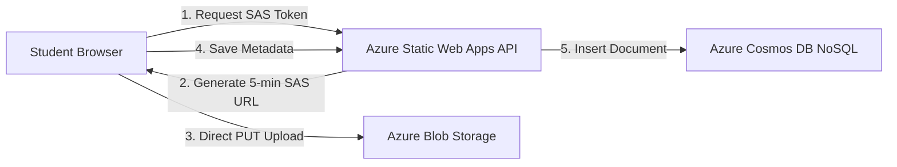

# CloudNotes: Serverless Azure Student Resource Hub

> A high-performance, cloud-native notes and study resource platform built on Microsoft Azure Free-Tier architecture.
> **Optimized for Azure for Students ($100 Credit)**: Keeps monthly operational costs between **$0.00 and $0.20/month**, allowing your credit to last the full 12-month period.

---

## 🏗️ Architecture Overview (Zero-Dollar Model)



### Why This Architecture Protects Your $100 Credit
- **No VMs or Paid App Service Plans (B1/S1):** Always-on servers drain $13–$40/month even when idle. Azure Static Web Apps scales to zero at **$0.00/mo**.
- **Valet Key Pattern:** Uploads go directly from the browser to Azure Blob Storage using a temporary write-only SAS URL. Serverless API uses **0 KB RAM and 0 KB bandwidth** for file transfers.
- **Cosmos DB Free-Tier Discount:** 1,000 RU/s provisioned throughput and 25 GB storage free forever per subscription.
- **Enforced 15 MB Limit:** Prevents multi-gigabyte files from inflating storage bills.

---

## 📁 Repository Structure

```
aiman_minip/
├── api/                               # Azure Functions (v4 Node.js programming model)
│   ├── src/
│   │   └── functions/
│   │       ├── generateUploadUrl.js  # Blob SAS generator (15MB guardrail)
│   │       ├── notes.js              # GET & POST notes (Cosmos DB)
│   │       └── upvote.js             # Upvote handler (1-RU point read)
│   ├── host.json
│   ├── package.json
│   └── local.settings.json.example
├── public/
│   └── favicon.svg
├── src/
│   ├── components/
│   │   ├── ArchitectureModal.jsx    # Visual zero-cost Azure architecture breakdown
│   │   ├── CostGuardBanner.jsx      # Credit tracker & cost monitoring helper
│   │   ├── FilterBar.jsx            # Course, semester & department filters
│   │   ├── Navbar.jsx               # Header & user auth status
│   │   ├── NoteCard.jsx             # Card with stats, preview & download
│   │   ├── NoteDetailModal.jsx      # Detail preview & Cosmos DB JSON inspector
│   │   ├── StatsOverview.jsx        # Summary metrics
│   │   └── UploadModal.jsx          # Valet-key SAS direct upload workflow
│   ├── services/
│   │   ├── api.js                   # Client API layer (calls /api or falls back to local storage)
│   │   └── mockData.js              # Initial university notes dataset
│   ├── App.jsx
│   ├── App.css
│   ├── index.css
│   └── main.jsx
├── index.html
├── package.json
├── staticwebapp.config.json          # Azure Static Web Apps routing & security headers
├── vite.config.js
└── README.md
```

---

## 🚀 Running Locally

```bash
# 1. Install frontend dependencies
npm install

# 2. Run frontend development server
npm run dev
```
Open [http://localhost:3000](http://localhost:3000) to view the application.

---

## ☁️ Step-by-Step Azure Deployment Plan

### Phase 1: Set Up Azure Resource Group & Budget Alert (Must Do First!)
1. Log into [Azure Portal](https://portal.azure.com).
2. Create a Resource Group: `rg-studentnotes-prod` in your nearest region (e.g. `East US` or `Central India`).
3. Navigate to **Cost Management + Billing** -> **Budgets**.
4. Set a monthly budget of **$10.00** with alerts at **50% ($5)** and **80% ($8)** sent to your email.

### Phase 2: Create Azure Storage Account & Container
1. Create a Storage Account (Standard LRS, Hot Tier).
2. Under **Data storage** -> **Containers**, create a private container named `student-resources`.
3. Under **Settings** -> **Resource Sharing (CORS)**, add a rule:
   - Allowed origins: `http://localhost:3000` and your production URL.
   - Allowed methods: `GET, PUT, HEAD, OPTIONS`.
   - Allowed headers: `*`.
   - Exposed headers: `*`.

### Phase 3: Create Azure Cosmos DB NoSQL (Free Tier)
1. In Azure Portal, search for **Azure Cosmos DB** -> create **Azure Cosmos DB for NoSQL**.
2. **Crucial:** In the Basics tab, ensure **Apply Free Tier Discount** is checked.
3. Once provisioned, open **Data Explorer** -> create Database `NotesDB` and Container `Resources`.
4. Set partition key to `/courseCode` and provisioned throughput capped at 1,000 RU/s (or 400 RU/s).

### Phase 4: Deploy with Azure Static Web Apps
1. Push this project to your GitHub repository.
2. In Azure Portal, search for **Static Web Apps** -> **Create**.
3. Choose the **Free** hosting plan.
4. Link your GitHub account, select your repository, and set:
   - **App location**: `/`
   - **Api location**: `api`
   - **Output location**: `dist`
5. Azure will automatically generate a GitHub Actions workflow that builds and deploys both frontend and backend functions!
6. In your Static Web App, go to **Configuration** -> **Application settings** and add:
   - `AZURE_STORAGE_CONNECTION_STRING`: `<your_storage_connection_string>`
   - `STORAGE_CONTAINER_NAME`: `student-resources`
   - `COSMOS_CONNECTION_STRING`: `<your_cosmos_connection_string>`
   - `COSMOS_DATABASE_ID`: `NotesDB`
   - `COSMOS_CONTAINER_ID`: `Resources`
